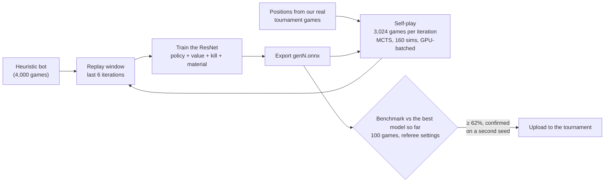
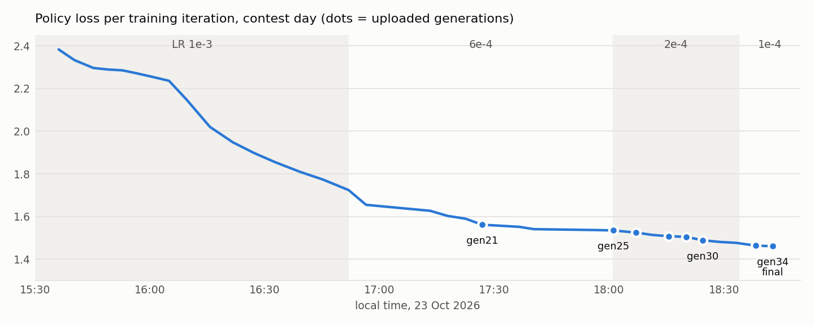

# 2nd place: 42nd Cloudflight Coding Contest, Data/AI track ("Colony: One")

An AlphaZero-style self-play pipeline that trained a policy/value network from scratch **in under four hours**, during
the contest itself, on one desktop PC. The network we had uploaded at the end, **gen34**, finished **2nd out of 382
teams** in the live Level 4 tournament.

| Rank | Team | Rating |
|---:|---|---:|
| 1 | 404 Brain Not Found | 3099 |
| **2** | **us** (listed as `placeholder-htbluva`) | **2819** |
| 3 | Acica | 2744 |
| 4 | 66.67 percent AC on TC 100 | 2610 |
| 5 | NoClueCrew | 2587 |

Final standings of the 42nd Data/AI CCC, 23 Oct 2026 ([Hall of Fame](https://codingcontest.org/hall-of-fame), AI / Data tab).

**Team:** Leon Jevtić ([@LeonJevtic](https://github.com/LeonJevtic)), Lenard Grösswang
([@lGroesswang](https://github.com/lGroesswang)), Jakob Kölblinger ([@JakobKoelblinger](https://github.com/JakobKoelblinger))

---

## Contents

- [The task in one minute](#the-task-in-one-minute)
- [What we built](#what-we-built)
- [How the 4 hours went](#how-the-4-hours-went)
- [What made the difference](#what-made-the-difference)
- [Where gen34 still loses](#where-gen34-still-loses)
- [After the contest: gen78](#after-the-contest-gen78)
- [Repository layout](#repository-layout)
- [Setup](#setup)
- [Usage](#usage)
- [License](#license)

Deeper write-ups live in [`docs/`](docs):
[the game](docs/the-game.md) · [how it works](docs/how-it-works.md) · [the training run](docs/training-run.md) ·
[evaluation](docs/evaluation.md) · [after the contest](docs/after-the-contest.md) · [code map](docs/code-map.md)

## The task in one minute

*Colony: One* is a two-player game on an 8x8 board. Each side has six pieces, a turn consists of **two actions**, and you
lose when your **Kernel** is destroyed. A shrinking **firewall** burns the outer ring after rounds 8, 16, 24 and 26, so
every game ends after at most 26 rounds. ([Full summary](docs/the-game.md).)

Level 4 was a live tournament. Every team uploads **one ONNX network** (at most 5 MiB) that maps a position to:

- `policy`: 4096 logits, one per (from-square, to-square) action, and
- `value`: the expected result for the side to move, in `[-1, 1]`.

The server plays all games itself with a **fixed referee MCTS** (100 simulations per action) and uses your network to guide
your side's search. Ratings are Glicko-2. You may re-upload whenever you like, so the game during the contest was:
train as fast as possible, check whether a new generation is really better, upload, repeat.

## What we built



- **Network** ([`az/net.py`](az/net.py)): a 64-channel, 6-block residual network (about 0.5 M parameters, 2 MB as ONNX).
  - The policy head is *bilinear*: every square gets a "from" and a "to" embedding, and the logit of an action is their
    dot product plus learned biases. That covers all 4096 actions with very few weights.
  - A **kill head** predicts "the side to move can destroy the enemy Kernel this turn". The exported value is
    `k + (1 - k) * v`, so a forced win is recognised even when the value head is unsure.
  - A **material head** (training only) predicts the material balance a few actions ahead and teaches the trunk about
    exchanges.
- **Self-play** ([`az/gpu_selfplay.py`](az/gpu_selfplay.py)): 18 CPU worker processes each keep 32 games in flight and send
  all their leaf positions to the GPU in one batch. One iteration (3,024 games, about 70,000 training positions) took
  4-6 minutes on a Ryzen 9 7900X3D + RTX 4080 SUPER.
- **Training data mix**: besides plain self-play, games against older generations (a small "league"), against a
  hand-built defensive bot, from random endgame positions, and from positions out of **our own tournament games**,
  which we downloaded from the contest dashboard while the tournament was running.
- **Evaluation** ([`az/arena.py`](az/arena.py), [`az/watch.py`](az/watch.py)): every new generation automatically
  played 100 games against the best model so far under exactly the referee's settings. As a rule, a generation was only
  uploaded if it scored at least 62% and held up in a second run with a new seed.

Details: [docs/how-it-works.md](docs/how-it-works.md).

## How the 4 hours went

| Time | What happened |
|---|---|
| 15:32 | Training starts from zero: 4,000 games of a hand-written heuristic bot bootstrap generation 1. |
| 16:10 | Switch to GPU-batched self-play: 3,024 games per iteration instead of 1,000. |
| 16:20-17:20 | Real-tournament start positions, random endgame starts, a kill head and synthetic "can you kill now?" positions are added. |
| 16:52 | Learning rate 1e-3 → 6e-4. gen17, the first generation trained with it, beats gen15 84%. |
| 17:34 | gen21 uploaded. |
| 18:01 | gen25 beats gen21 75% (uploaded 18:05). Learning rate 6e-4 → 2e-4. |
| 18:13-18:29 | gen26, gen28 and gen30 uploaded, each 61-69% against the one before. |
| 18:34 | Learning rate 2e-4 → 1e-4. gen33 beats gen30 69%. Uploaded 18:41. |
| **18:46** | **gen34 uploaded: 71% against gen33. It stayed live until the end and finished 2nd.** |

<picture>
  <source media="(prefers-color-scheme: dark)" srcset="docs/img/training-run-dark.png">
  
</picture>

Over those 3 hours 10 minutes the pipeline played **87,600 self-play games (about 2.5 million training positions)** and
produced 34 generations. Per-iteration numbers: [docs/training-run.md](docs/training-run.md); raw log:
[`results/training_log.txt`](results/training_log.txt).

## What made the difference

1. **Lowering the learning rate step by step.** We lowered it by hand three times during the run (1e-3 → 6e-4 → 2e-4 → 1e-4).
   gen17, the first generation after the first drop, beat gen15 84%. gen33 and gen34, the first two
   after the last drop, beat their predecessors 69% and 71%.
2. **Measuring before uploading.** With 100 games the standard error is about 5 percentage points; one candidate
   scored 64% and then 54% on a second seed. Every upload resets part of the Glicko-2 placement, so we only uploaded
   generations that won twice.
3. **Playing positions from the real tournament.** Opponents in the tournament steered into positions our self-play never
   reached. Starting 10% of self-play games from positions of our own tournament games closed part of that gap.
4. **A kill head and kill labels.** Many games are decided by a two-action Kernel attack. Exact "can the side to move
   win this turn?" labels, computed by brute force, made the network see these tactics directly instead of learning
   them only from game results.
5. **Fast, GPU-batched self-play.** Moving the network evaluation of all concurrent games into one GPU batch tripled the
   number of games per iteration.

Things we tried that did **not** help: changing the policy temperature at export, averaging the weights of several
generations (SWA), and scaling the value output. See [docs/evaluation.md](docs/evaluation.md).

## Where gen34 still loses

We downloaded and analysed every lost tournament game. Our models won almost all games against everyone except the
teams that finished 1st, 3rd and 7th.
The losses fall into a few patterns:

- **Hopeless-looking positions:** a few turns before the end, every move looks equally lost to the network, so the
  100-simulation search stops looking for the (often existing) safe move.
- **Kernel on the firewall ring:** the Kernel stays on the outer ring and burns when the ring locks, although an escape
  existed one turn earlier.
- **Bare-Kernel endgames:** when only the Kernels are left, the more central one wins, and ours was often not central.
- **A known opening trap** as Magenta against one of the top teams.

Details and concrete positions: [docs/evaluation.md](docs/evaluation.md#why-we-lost-games).

## After the contest: gen78

We kept training for about four more hours after the contest ended, to find out how far the approach goes. The best
result is [`models/gen78.onnx`](models/gen78.onnx). It was **never uploaded**, so it has no tournament rating, but
locally it is clearly stronger:

- gen40 beat gen34 86.5% and gen44 beat gen34 84% from the start position.
- From gen44 on, each promoted generation beat its predecessor on positions from our real tournament games, up to gen78,
  which also beat gen71 88/100 from the start position.

The main changes were a value target capped at 0.95, more weight on the search result in the value target,
**"rescue" labels** that rewrite the policy target whenever self-play blundered into a one-turn loss although a safe turn
existed, and an automatic promoter that judges new generations on held-out tournament positions instead of start-position
matches. The full story, including three bugs we found along the way: [docs/after-the-contest.md](docs/after-the-contest.md).

## Repository layout

```
az/                 training pipeline (self-play, training, evaluation, export)
analysis/           scripts we used to analyse games and test ideas
models/             gen34.onnx (our submission) and gen78.onnx (post-contest), with a model card
results/            training log, benchmark log and manual test results
docs/               write-ups: the game, how it works, the training run, evaluation, after the contest, code map
defensive.onnx      small hand-built defensive bot, used as a fixed sparring partner in self-play
run_train.sh        endless training loop (restarts the trainer and re-reads runs/r1/args.txt)
requirements.txt    Python packages
```

The game engine and the referee search (`colony_one/`), the validator (`tools/`) and the match script (`play/`) are part of
the organizer's starter kit and are **not included** here (see [Setup](#setup)).

## Setup

1. Get the Level 4 starter kit of the 42nd CCC Data/AI contest ("Colony: One") from the contest website. It contains
   the `colony_one` package, `tools/validate_submission.py` and `play/model_vs_model.py`.
2. Copy its `colony_one/`, `tools/` and `play/` folders into the root of this repository (they are in `.gitignore`), or
   install the kit with `pip install -e <path-to-kit>`.
3. Create a Python 3.11-3.13 environment and install the requirements. Training needs an NVIDIA GPU, so install a
   CUDA build of PyTorch first ([pytorch.org](https://pytorch.org/get-started/locally/)). Evaluating and playing the
   ONNX models works on CPU.

```bash
python -m venv .venv
source .venv/bin/activate        # Windows: .venv\Scripts\activate
pip install -r requirements.txt
```

We trained on Windows 10 with Python 3.13, PyTorch 2.6 (CUDA 12.4), a Ryzen 9 7900X3D (24 threads) and an
RTX 4080 SUPER (16 GB). The defaults (`--workers 18`) assume a machine of that size; scale them down on smaller hardware.

## Usage

All commands run from the repository root.

**Train** (the configuration that produced gen34):

```bash
mkdir -p runs/r1
python -m az.train --run runs/r1 --gpu-selfplay --workers 18 --games 3024 --chunk 56 --concurrent 32 \
  --sims 160 --temp-moves 8 --q-mix 0.4 --window 6 --league 2,4,8 \
  --opponents defensive.onnx --opp-frac 0.15 --late-frac 0.45 --open-sharpen 2.0 \
  --aux-rate 0.015 --aux-window 3 --lr 0.0001 --iters 100000
```

During the contest the learning rate started at 1e-3 and was lowered by hand (6e-4, 2e-4, 1e-4), and the options above
were switched on one by one. The tournament-position and synthetic-kill files (`--tourney-file`, `--synth-file`) need
your own downloaded tournament games and are optional. The exact history is in
[docs/training-run.md](docs/training-run.md#configuration-history). `run_train.sh` runs the trainer in an endless loop
with the arguments in `runs/r1/args.txt`.

**Compare two models** under the referee's settings:

```python
from multiprocessing import Pool
from az import arena

if __name__ == "__main__":
    with Pool(6) as pool:
        print(arena.match("models/gen78.onnx", "models/gen34.onnx", games=100, sims=100, pool=pool, seed=1))
```

**Validate a model** before uploading (validator from the starter kit):

```bash
python tools/validate_submission.py models/gen34.onnx
```

More scripts: [docs/code-map.md](docs/code-map.md).

## License

The code builds on the organizer's *Colony: One* environment (© 2026 Paul Puntschart), whose license requires derivative
works to keep its terms. This repository is therefore distributed under the same **non-commercial** license terms; see
[LICENSE](LICENSE). The starter kit itself and the contest's task statements are not included.
