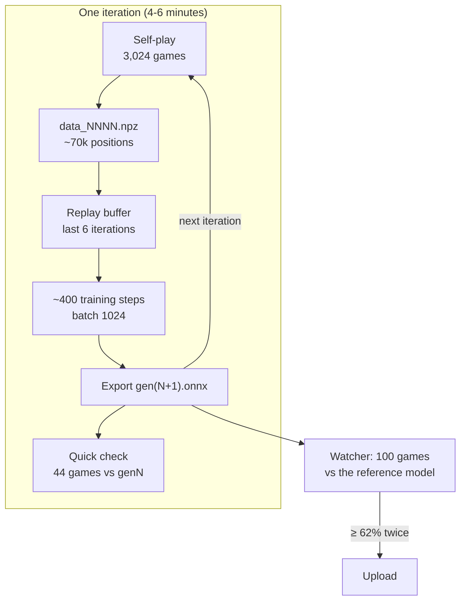

# How it works

The pipeline is a compact AlphaZero: a network guides a tree search, the search plays games against itself, and the
network is trained to predict what the search chose and who won. This page walks through each part with the settings that
produced gen34. File references point into [`az/`](../az).



## Input

The network sees the position from the point of view of the side to move: 16 planes of 8x8
(the encoding is defined by the organizer's engine).

| Planes | Content |
|---|---|
| 0-5 | own Ping, Daemon, Exploit, Trace, Ice, Kernel |
| 6-11 | the opponent's pieces, same order |
| 12 | squares already locked by the firewall |
| 13 | actions left in this turn (1.0 or 0.5) |
| 14 | firewall urgency: rises towards 1.0 as the next lock approaches |
| 15 | 1.0 if Magenta is to move (Magenta wins all tie-breaks, so the same position is worth more to Magenta) |

When Magenta moves, the board is rotated by 180 degrees so that "own" pieces always start on the same side. An action is
`from_square * 64 + to_square`, which gives 4096 possible actions; the referee masks the illegal ones.

## Network

[`az/net.py`](../az/net.py), 64 channels, 6 residual blocks, about 0.5 million parameters.

```
input (16x8x8)
  └─ 3x3 conv, 64 ch + BatchNorm + ReLU
     └─ 6 x residual block (two 3x3 convs with BatchNorm)
        ├─ policy head:  two 1x1 convs give every square a 32-dim "from" and "to" embedding plus a bias each
        │                logit(from, to) = <from, to> / sqrt(32) + bias_from + bias_to + learned per-action bias
        ├─ value head:   1x1 conv (4 ch) flattened + global average of the trunk → 128 → 1, tanh   = v
        ├─ kill head:    1x1 conv → one score per square → max over the board → sigmoid            = k
        └─ material head (training only): 128 → 1, tanh
value = k + (1 - k) * v
```

- **Bilinear policy head.** A fully connected layer to 4096 outputs would need about 1 million weights per input feature.
  Scoring "from" and "to" squares separately and combining them with a dot product covers all 4096 actions with a few
  thousand weights and generalises across squares.
- **Kill head.** `k` estimates "the side to move can destroy the enemy Kernel during this turn". Since that is a certain
  win, the exported value is `k + (1 - k) * v`: if a kill is available, the value goes to 1 whatever the value head
  says. The head is trained on exact labels (see below). Its bias starts at -6, so when it was added mid-run the old
  value function was unchanged.
- **Material head.** Predicts the material balance 8 actions later. It is not exported; it only gives the trunk an extra
  signal about exchanges.

**Export** (`export_onnx`): `torch.onnx.export` with opset 17 and a dynamic batch axis. Two fixes make the file pass the
validator: the policy width is written as a fixed 4096 instead of a symbolic dimension, and every `Constant` node
(not on the referee's operator allow-list) is turned into an initializer. The code in this repository also ends every
export in a `Clip(-1, 1)` on the value; that fix came after gen50 was rejected, so gen34 was exported without it (see
[after the contest](after-the-contest.md#bugs-we-found-and-fixed)).

## Bootstrapping: the heuristic bot

Iteration 0 has no network yet. [`az/heuristic.py`](../az/heuristic.py) is a hand-written evaluator with the same
interface as a network, so it can drive the same search:

- material with weights Ping 1, Exploit 1.7, Trace 2, Daemon 3, Ice 3.3,
- +0.6 per bodyguard next to the own Kernel (at most 2),
- a penalty for pieces, and especially the Kernel, on the next ring to lock, growing as the lock approaches,
- a bonus for a central Kernel, growing as the board shrinks,
- a move prior that prefers captures of valuable pieces.

4,000 games of this bot were the first training data. gen1, trained on them, beat the bot 43 of 44 games.

## Self-play

[`az/gpu_selfplay.py`](../az/gpu_selfplay.py), switched on at 16:10.

- **Same search as the referee.** Self-play uses the organizer's MCTS code (PUCT with c = 1.5) through a small wrapper,
  so the network learns for exactly the search it will be judged with. Differences: 160 simulations instead of 100,
  more Dirichlet noise at the root (ε = 0.25), and the first 8 actions are sampled in proportion to the visit counts.
- **Many games per process, one GPU batch.** The search is written as a generator that pauses whenever it needs a
  network evaluation. Each of the 18 worker processes keeps 32 games in flight, collects their pending positions and
  evaluates them in one batch on the GPU. The network runs in half precision with CUDA graphs captured for batch sizes
  16-256. This tripled the number of games per iteration (1,000 → 3,024) at about the same time per iteration.
- **Fresh workers every iteration.** The worker processes leaked about 2.8 GB of GPU memory per iteration and stalled
  the trainer at 17:44. Since then the worker pool is closed and re-created after every self-play phase.

### Training targets

Every position in a self-play game is stored with:

- **policy target:** the search's visit counts over the legal actions (at most 128 per position). For the first 8 actions
  the counts are squared and renormalised (`--open-sharpen 2.0`). The referee samples our opening moves from the visit
  counts, so a sharper opening policy wastes fewer of those 8 random draws on bad moves.
- **value target:** `(1 - q_mix) * z + q_mix * q`, where `z` is the game result (+1 / -1) for the side to move and `q`
  is the search's average value at the root. For gen34, `q_mix` was 0.4.
- **kill label:** whether the side to move can win during this turn, computed exactly (below).
- **material label:** the material balance 8 actions later.

### Where the games start

Plain self-play from the initial position explores a narrow set of lines, so the games were mixed:

| Share (gen34 run) | Games |
|---|---|
| 15% | against fixed opponents, split evenly between `defensive.onnx` (a small hand-built defensive network, about 1,000 parameters) and our own generations from 2, 4 and 8 iterations back (`--league 2,4,8`); only our side's positions are recorded |
| 45% of the rest | self-play from a random late-game position: rounds 5-26, both Kernels plus a random subset of pieces, rejected if the side to move can win at once |
| 10% of the rest | self-play from a position of one of **our real tournament games** (positions from lost games are included three times) |
| the rest | self-play from the normal initial position |

In the iteration that produced gen34 that meant 114 games against `defensive.onnx`, 113 against each of three older
generations, about 1,440 games from late or tournament positions and about 1,130 from the initial position.

The tournament positions come from game files we downloaded from the contest dashboard during the tournament
([`az/tourney_positions.py`](../az/tourney_positions.py)). They are not included in this repository.

## Exact kill labels

Many games end with a two-action attack: remove the bodyguard, then hit the Kernel. A value head trained only on game
results learns that slowly. [`az/tactics.py`](../az/tactics.py) computes it exactly:

- `can_kill(board, team, actions_left)`: tries every action, and with two actions left every pair of actions, and checks
  whether the enemy Kernel is hit with no bodyguard next to it.
- `firewall_doom(board, team, round)`: Magenta to move in a lock round while Cyan's Kernel stands on the ring that is
  about to lock.
- `wins_this_turn` = either of the two.

We checked it against a brute-force search of the real engine on random positions (`analysis/check_labels.py`, 1,500 of
1,500 correct). The labels train the kill head on:

- every recorded position,
- 1.5% of all positions visited inside the search tree (`--aux-rate 0.015`), which include many tactical positions the
  played games never reach,
- synthetic positions built by [`az/synth.py`](../az/synth.py), focused on the rare case of a Kernel standing on the ring
  that is about to burn.

## Training

[`az/train.py`](../az/train.py)

| Setting | Value |
|---|---|
| Replay buffer | positions from the last 6 iterations (about 430,000) |
| Steps per iteration | `new positions x 6 / batch size`, so each position is seen about 6 times in total (about 400 steps) |
| Batch size | 1024 |
| Optimizer | AdamW, weight decay 1e-4 |
| Learning rate | 1e-3, lowered by hand to 6e-4, 2e-4 and 1e-4 (see [training run](training-run.md)) |
| Augmentation | half of each batch is mirrored along the anti-diagonal; the rules are symmetric under it |
| Loss | policy cross-entropy + value MSE + 0.5 x kill binary cross-entropy + 0.5 x material MSE |

The trainer runs forever. [`run_train.sh`](../run_train.sh) restarts it whenever it exits and re-reads the arguments from
`runs/r1/args.txt`, so a new setting takes effect by editing that file and killing the trainer right after an iteration;
it resumes from the checkpoint.

## From a generation to an upload

1. After each iteration the trainer exports `gen(N+1).onnx` and plays a quick 44-game check against the previous
   generation (100 simulations, colours alternating).
2. A separate watcher ([`az/watch.py`](../az/watch.py)) plays 100 games of every new generation against the reference (the
   best model so far) with the referee's exact settings and marks it as a candidate at 62% or more.
3. A candidate gets a second 100-game run with a new seed. Only if it holds up is it validated with the organizer's
   validator and uploaded, and it becomes the new reference.

Why so careful: 100 games have a standard error of about 5 percentage points, and every upload restarts part of the
Glicko-2 placement. More on evaluation: [evaluation.md](evaluation.md).
