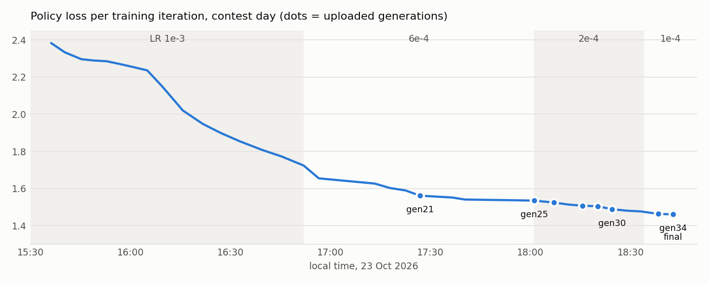

# The training run: gen1 to gen34 in 3 hours 10 minutes

Everything below comes from [`results/training_log.txt`](../results/training_log.txt) (one `selfplay`, `train` and
`arena` line per iteration) and [`results/promoter_log.txt`](../results/promoter_log.txt) (the benchmark watcher). Times are
local time (CEST) on 23 Oct 2026.

## Summary

| | |
|---|---|
| Start of training | 15:32 (from zero, no pre-trained weights) |
| gen34 finished | 18:42 (end of iteration 33) |
| Uploaded | 18:46, live until the end of the contest |
| Self-play games until gen34 | 87,600 (4,000 bootstrap games by a heuristic bot + 83,600 network games) |
| Training positions until gen34 | about 2.5 million |
| Time per iteration | 4-6 minutes: self-play about 200-300 s, training about 25 s, quick check about 10 s |
| Hardware | one PC: Ryzen 9 7900X3D (24 threads), RTX 4080 SUPER (16 GB), Windows 10 |

<picture>
  <source media="(prefers-color-scheme: dark)" srcset="img/training-run-dark.png">
  
</picture>

The policy loss measures how well the network predicts the search's move choice. It keeps falling even though the
opponents (older versions of itself) get stronger at the same time. The dots mark every generation we uploaded from
17:34 on (gen21, 25, 26, 28, 29, 30, 33, 34); four of them are labelled.

## Generations

"Quick check" is the trainer's own 44-game match of the new generation against the previous one (or the heuristic
bot), right after training. "Benchmark" is the separate watcher process: 100 games of the new generation against the
current reference model with the referee's exact settings; ≥ 62% marks a candidate. Not every iteration got both.

| Iteration | Done | LR | Games | Positions | Policy loss | Value loss | New gen | Quick check | Benchmark vs reference | Uploaded |
|---:|---|---|---:|---:|---:|---:|---|---|---|---|
| 0 | 15:36 | 1e-3 | 4,000 | 142,146 | 2.383 | 0.428 | gen1 | 43/44 vs heuristic | | |
| 1 | 15:40 | 1e-3 | 1,000 | 42,683 | 2.333 | 0.383 | gen2 | 25/44 vs gen1 | | |
| 2 | 15:45 | 1e-3 | 1,000 | 47,207 | 2.296 | 0.374 | gen3 | | | |
| 3 | 15:49 | 1e-3 | 1,000 | 36,140 | 2.289 | 0.369 | gen4 | 19/44 vs gen3 | | |
| 4 | 15:52 | 1e-3 | 1,000 | 35,764 | 2.285 | 0.366 | gen5 | 31/44 vs gen4 | | |
| 5 | 15:56 | 1e-3 | 1,000 | 37,063 | 2.271 | 0.363 | gen6 | 25/44 vs gen5 | | |
| 6 | 16:00 | 1e-3 | 1,000 | 38,377 | 2.254 | 0.358 | gen7 | 18/44 vs gen6 | | |
| 7 | 16:05 | 1e-3 | 1,000 | 39,036 | 2.236 | 0.358 | gen8 | 26/44 vs gen7 | | |
| 8 | 16:09 | 1e-3 | 1,000 | 38,205 | 2.148 | 0.339 | gen9 | | | |
| 9 | 16:15 | 1e-3 | 3,024 | 119,121 | 2.020 | 0.286 | gen10 | 34/44 vs gen9 | | |
| 10 | 16:21 | 1e-3 | 3,024 | 118,489 | 1.948 | 0.254 | gen11 | | | |
| 11 | 16:27 | 1e-3 | 3,024 | 90,283 | 1.898 | 0.241 | gen12 | | | |
| 12 | 16:33 | 1e-3 | 3,024 | 93,396 | 1.854 | 0.232 | gen13 | 27/44 vs gen12 | | |
| 13 | 16:39 | 1e-3 | 3,024 | 90,814 | 1.809 | 0.221 | gen14 | 21/44 vs gen13 | | |
| 14 | 16:45 | 1e-3 | 3,024 | 87,895 | 1.773 | 0.210 | gen15 | 18/44 vs gen14 | 69% | |
| 15 | 16:51 | 1e-3 | 3,024 | 92,997 | 1.724 | 0.203 | gen16 | | | |
| 16 | 16:56 | 6e-4 | 3,024 | 88,348 | 1.655 | 0.193 | gen17 | 31/44 vs gen16 | 84% vs gen15 | |
| 17 | 17:13 | 6e-4 | 3,024 | 80,824 | 1.627 | 0.189 | gen18 | 24/44 vs gen17 | | |
| 18 | 17:17 | 6e-4 | 3,024 | 83,448 | 1.603 | 0.185 | gen19 | | 70% | |
| 19 | 17:22 | 6e-4 | 3,024 | 81,906 | 1.590 | 0.186 | gen20 | 23/44 vs gen19 | | |
| 20 | 17:26 | 6e-4 | 3,024 | 79,044 | 1.562 | 0.182 | gen21 | | 64% | 17:34 |
| 21 | 17:36 | 6e-4 | 3,024 | 74,876 | 1.552 | 0.182 | gen22 | 23/44 vs gen21 | | |
| 22 | 17:40 | 6e-4 | 3,024 | 69,918 | 1.541 | 0.180 | gen23 | 22/44 vs gen22 | 64%, then 54% on a 2nd seed | |
| 23 | 17:56 | 6e-4 | 3,024 | 72,492 | 1.537 | 0.179 | gen24 | 24/44 vs gen23 | | |
| 24 | 18:01 | 6e-4 | 3,024 | 72,311 | 1.535 | 0.181 | gen25 | 26/44 vs gen24 | 74% | 18:05 |
| 25 | 18:07 | 2e-4 | 3,024 | 71,806 | 1.525 | 0.178 | gen26 | 33/44 vs gen25 | 61% vs gen25 (200 games) | 18:13 |
| 26 | 18:11 | 2e-4 | 3,024 | 69,937 | 1.514 | 0.182 | gen27 | 23/44 vs gen26 | | |
| 27 | 18:15 | 2e-4 | 3,024 | 71,619 | 1.508 | 0.185 | gen28 | 29/44 vs gen27 | 63% | 18:20 |
| 28 | 18:20 | 2e-4 | 3,024 | 74,238 | 1.505 | 0.189 | gen29 | 22/44 vs gen28 | 54% | briefly |
| 29 | 18:24 | 2e-4 | 3,024 | 69,834 | 1.489 | 0.191 | gen30 | 30/44 vs gen29 | 67% | 18:29 |
| 30 | 18:29 | 2e-4 | 3,024 | 69,652 | 1.481 | 0.191 | gen31 | 27/44 vs gen30 | 56% | |
| 31 | 18:33 | 2e-4 | 3,024 | 70,784 | 1.477 | 0.191 | gen32 | 29/44 vs gen31 | 56% | |
| 32 | 18:38 | 1e-4 | 3,024 | 70,516 | 1.464 | 0.187 | gen33 | 30/44 vs gen32 | 73% | 18:41 |
| **33** | **18:42** | 1e-4 | 3,024 | 72,034 | 1.461 | 0.191 | **gen34** | **35/44 vs gen33** | **73%; 71% vs gen33 over 200 games** | **18:46, final** |

The value loss stops falling after iteration 25 although the models keep getting stronger. That is expected in
self-play: the opponents get stronger at the same rate, so the games do not get easier to predict.

gen29 was uploaded for a few minutes although it only scored 54%: it avoided a specific opening trap of one of the top
teams that gen28 fell into (see [evaluation](evaluation.md#why-we-lost-games)). gen30 replaced it as soon as it was
confirmed.

The quick check plays only 44 games and shows a lot of noise (gen15 lost its quick check 18/44 but scored 69% in the
benchmark). We used it only as a sanity check and decided uploads on the benchmark plus a second run.

## Configuration history

The trainer re-reads its arguments on every restart, so features were switched on one at a time while it was running.
The training log records the full configuration at every restart.

| From iteration (time) | Change |
|---|---|
| 0 (15:32) | Start: 22 workers, 1,000 games per iteration, 128 simulations, LR 1e-3, `q_mix` 0.25, window 8. Iteration 0 = 4,000 games of the heuristic bot. |
| 3 (15:45) | Sparring games against `defensive.onnx` (20% of games). |
| 9 (16:10) | **GPU-batched self-play**: 18 workers x 32 concurrent games, 3,024 games per iteration, 160 simulations, `q_mix` 0.4, window 6, opening temperature for the first 8 actions (was 12), league of older generations (2, 4 and 8 generations back). |
| 11 (16:22) | 35% of games start from random late positions (`--late-frac`); opening targets sharpened (`--open-sharpen 2.0`); sparring share 15%. |
| 12 (16:27) | **Kill labels** for 1.5% of search leaves (`--aux-rate 0.015`), training the kill head. |
| 16 (16:52) | LR 1e-3 → 6e-4. |
| 17 (17:09) | 10% of games start from positions of our real tournament games (`--tourney-file`, `--tourney-frac 0.1`). |
| 19 (17:18) | Synthetic kill positions mixed into training (`--synth-file`). |
| 21 (17:27) | Late-position share 35% → 45%; material head (`mat` loss) appears in the log. |
| 23 (17:44-17:56) | The trainer stalled: self-play workers leaked GPU memory until the 16 GB card was full. Fixed by re-creating the worker pool after every self-play phase. |
| **25 (18:01)** | **LR 6e-4 → 2e-4.** |
| **32 (18:34)** | **LR 2e-4 → 1e-4.** |
| 35 (18:47) | After gen34: value target capped at 0.95 and `q_mix` 0.55. These belong to the post-contest run. |

The arguments in effect when gen34 was trained (iterations 32-33):

```
--run runs/r1 --resume --gpu-selfplay --workers 18 --games 3024 --chunk 56 --concurrent 32 --sims 160
--temp-moves 8 --q-mix 0.4 --window 6 --league 2,4,8 --opponents defensive.onnx --opp-frac 0.15
--late-frac 0.45 --open-sharpen 2.0 --aux-rate 0.015 --aux-window 3 --lr 0.0001
--tourney-file matches/tourney_positions.npz --tourney-frac 0.1 --synth-file matches/synth_kill.npz --iters 100000
```

Note for reproducing: the code in this repository is the final, post-contest version. All features added after gen34
are off unless their flags are set, with one exception: the value-target cap of 0.95 in `az/train.py`
(`vt = buf["v"][sel] * 0.95`) is always on. To train exactly like the gen34 run, remove the `* 0.95`.

## Uploads during the contest

| Time | Model | Evidence |
|---|---|---|
| 17:34 | gen21 | 64% vs gen19 |
| (briefly) | gen21 with value x1.5 | one teammate's manual tweak: same weights, value scaled by 1.5 and clipped; 60.5% vs gen21 over 200 games |
| 18:05 | gen25 | 75% vs gen21 (74 + 76 on two seeds) |
| 18:13 | gen26 | 61% vs gen25 (60 + 62) |
| 18:20 | gen28 | 61.7% vs gen26 (63, 55, 67 on three seeds) |
| (briefly) | gen29 | 53% vs gen28, but avoids an opening trap |
| 18:29 | gen30 | 69% vs gen28 (67 + 71), 66% vs gen29 |
| 18:41 | gen33 | 69% vs gen30 (73 + 65) |
| **18:46** | **gen34** | **71% vs gen33 (73 + 69)**, the final upload |

Our notes do not record uploads before 17:34.
